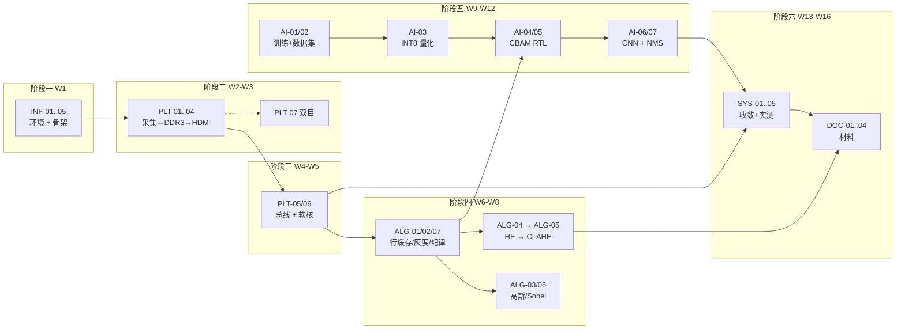

# 04 · 项目工作流程（Workflow Playbook）

> **本文件回答"怎么干"。**
> [`01-项目方案归档.md`](01-%E9%A1%B9%E7%9B%AE%E6%96%B9%E6%A1%88%E5%BD%92%E6%A1%A3.md) 回答"做什么"，[`02-目标分类.md`](02-%E7%9B%AE%E6%A0%87%E5%88%86%E7%B1%BB.md) 回答"做到什么程度"，本文件回答**"每周怎么推进、模块怎么落地、卡点怎么决策"**。

---

## 〇、文档体系与阅读顺序

```
01 方案归档   →  做什么（原始方案，可追溯）
02 目标分类   →  做到什么程度（36 个目标 ID + KPI + 降级路径）★主控
03 资源避坑   →  拿什么、别踩什么
04 工作流程   →  怎么干（本文件）        ★执行
stages/ 阶段一~六 → 本周具体派工单
```

**已知的两处文档口径冲突（需团队统一后回填）**

| 项 | 状态 |
|---|---|
| git CLI | ✅ 已装 **2.55.0**（`C:\Program Files\Git\cmd\git.exe`，机器 PATH 已注册） |
| 仓库 | ✅ 已 `git init -b main`，`.gitignore` 就绪 |
| 首次提交 | ⏳ 待配置 `user.name` / `user.email` |

### 已知的两处文档口径冲突（需团队统一后回填）

| 冲突项 | 说法 A | 说法 B | 建议 |
|---|---|---|---|
| 总周期 | 16 周（docs 全篇） | 4 个月（外部简介） | 按 **16 周** 排期，4 个月按日历冗余处理 |
| M5 门禁判据 | AI-01/03/06 为 **P1**（02 文档） | M5 要求 **AI-01/03/06 至少一项跑通**（02 文档 §八） | **以 M5 为准**：说明 AI 硬件加速被事实上升格为门禁项，排期按 P0 对待 |

---

## 一、工程骨架（INF-05）—— 先把地基打好

目标 ID 要求 `rtl/ sim/ constr/ sw/ doc/ ip/` 目录规范。**补齐后**的完整骨架：

```
ziguang/
├── README.md
├── .gitignore
├── docs/                    # 本知识库（01~04 + stages/）
├── rtl/
│   ├── common/              # 通用模块：同步器、异步FIFO、打拍模板、axis 工具
│   ├── video_in/            # DVP 采样、HREF/PCLK 像素有效生成
│   ├── preprocess/          # 行缓存、灰度、高斯、HE、CLAHE、Sobel
│   ├── mem/                 # DDR3 控制器封装、乒乓帧缓存仲裁
│   ├── ai/                  # 量化卷积、CBAM 通道/空间注意力、NMS、CTC 解码
│   ├── display/             # HDMI 时序、OSD 字幕叠加
│   └── soc/                 # RISC-V 顶层、AXI 互联、自定义外设从机
├── sim/
│   ├── tb/                  # testbench（每模块一份）
│   ├── golden/              # Python 生成的 .mem 期望输出 ★
│   └── vectors/             # 输入激励 .mem
├── model/                   # ★ Python/Matlab 参考模型与算法验证脚本
│   ├── ref_he.py  ref_clahe.py  ref_conv.py  ref_cbam.py  ref_nms.py
│   └── metrics.py           # PSNR / SSIM / 对比度 计算
├── constr/                  # .fdc 时序约束（PDS）
├── sw/                      # RISC-V 软核 C 程序（Freedom Studio 工程）
├── ip/                      # PDS IP 核（DDR3 / PLL / RISC-V / AXI 互联）
├── tools/                   # ★ 本项目自建脚本（lint、导出、比对、看板）
├── gen/                     # ★ 生成物：.mem/.coe 权重、综合报告、时序报告
└── reports/                 # ★ 验收证据：仿真比对报告、带宽/延迟/资源/功耗实测
```

> ★ 标记的是目标分类文档中未显式列出、但对验收至关重要的目录。
> **没有 `reports/` 和 `model/` 的项目，最后写不出 PPT 上那三组量化数据。**

**`.gitignore` 必备条目**（PDS 工程目录可达数 GB）

```
gen/
reports/*.rpt
*.bit  *.fs  *.prj  *.pds  *.log  *.wdb
pds_workspace/  .Xil/  __pycache__/  *.pyc
```

**分支与提交规范**

| 项 | 规范 |
|---|---|
| 分支 | `main` 恒可综合；每人一条 `feat/<模块>`；合并前必须仿真通过 |
| 提交信息 | `[目标ID] 动词 + 对象`，例：`[ALG-05] 实现 CLAHE 双线性插值` |
| 接口冻结 | **AXI4-Stream 位宽/握手一旦冻结，改动须全员同步**（见 §三·接口契约） |
| 二进制 | 比特流、训练权重（>10MB）不入库，放网盘并在 README 记录版本号 |

---

## 二、系统工作流全景



**图层含义**：实线 = 强依赖（上游不完成则下游无法开始）；虚线 = 可并行或弱依赖。

### 关键路径（唯一一条，任何一环延误直接顺延交付）

```
INF-02 (PDS) ──▶ PLT-01 ──▶ PLT-03 (DDR3 带宽) ──▶ PLT-04 (全链路)
   ──▶ ALG-01 (行缓存) ──▶ ALG-04 (HE 保底) ──▶ ALG-05 (CLAHE)
   ──▶ AI-01 (训练) ──▶ AI-03 (量化) ──▶ AI-06 (CNN 加速器)
   ──▶ SYS-02 (时序收敛) ──▶ DOC-01..04 (材料)
```

> ⚠️ **两条隐藏依赖，务必提前布防**
> 1. **AI-01（训练）不依赖任何 FPGA 工作** —— 只依赖数据集。因此 **W2 起就应有人并行搞数据集与模型**，不要等 W9。W9 才开始找数据 = 直接踩 R7。
> 2. **SYS-01（时序约束）从 W6 起持续投入**，不是 W13 才开始的"收口工作"。

---

## 三、模块级工作流（核心方法论）

> 这是本项目**最容易被忽略、却决定成败**的一环。
> 避坑清单第 11 条"先用 Python/Matlab 验证算法，再移植 Verilog"—— 本节把它落成**可执行的六步标准流程**。

### 3.1 六步闭环

```
① 算法验证(Python)  →  ② 定点化  →  ③ RTL 实现  →  ④ 生成金标准激励
                                                              ↓
                    ⑥ 上板实测  ←  ⑤ 逐拍比对仿真(mismatch = 0)
```

| 步 | 动作 | 产出物 | 落到哪个目录 | 通过判据 |
|---|---|---|---|---|
| ① | Python/SciPy/skimage 实现算法，调参看效果 | 参考实现 + 效果对比图 | `model/ref_*.py` `reports/` | 效果肉眼可见/指标改善 |
| ② | 浮点 → 定点（Q8/Q10），定标定界 | 位宽表、误差曲线 | `model/` 注释 + 报告 | 与浮点误差 ≤ 1 LSB |
| ③ | Verilog 实现，级间打拍，valid 对齐 | RTL + 端口契约 | `rtl/<模块>/` | lint 通过、无 latch |
| ④ | 由 Python **同一份代码**导出输入/期望输出 | `vectors/*.mem` `golden/*.mem` | `sim/vectors` `sim/golden` | 尺寸/格式与 RTL 一致 |
| ⑤ | testbench 读 `$readmemh` 逐拍比对 | 比对报告 | `reports/sim_<模块>.md` | **mismatch = 0** |
| ⑥ | 上板，采资源/时序/带宽/延迟 | 实测数据 | `reports/` + KPI 看板 | 达到 02 文档 KPI |

> **关键纪律**：②③④ 必须由**同一份定点参数**驱动，否则"仿真对的、上板错的"这类玄学问题会耗掉你一整周。

### 3.2 接口契约（冻结项）

| 接口 | 方向 | 位宽 | 说明 |
|---|---|---|---|
| DVP 像素 | in | 8bit×2 | **valid 必须由 HREF & PCLK 共同生成**，不可直接用 PCLK |
| 图像流 | 内部 | **AXIS 8bit + tuser(SOF) + tlast(EOL)** | 灰度单通道，1080P 行有效 1920 |
| 配置总线 | in | AXI4-Lite 32bit | 软核 → 各模块寄存器 |
| 字幕 | out | RGBA 叠加 | OSD 层由软核写字符缓存 |

### 3.3 流水线纪律（ALG-07，P0）

- 每个功能级之间**必须插入寄存器**，禁止跨模块长组合路径。
- **`pixel_valid` 与行缓存读写指针严格同源对齐**：行缓存读地址的推进必须与 valid 同拍，不能各自计数。
- 每级延迟**显式登记**到模块头注释（总延迟 = 各级之和），供 SYS-04 延迟核算使用。
- 跨时钟域（像素域 → DDR3 域 → 显示域）一律走**异步 FIFO**，并登记到 `constr/` 约束清单。

### 3.4 带宽核算（澄清一个常见误判）

| 量 | 算法 | 结果 |
|---|---|---|
| 1080P@30fps 像素率 | 1920×1080×30 | **62.2 M pixel/s** |
| 灰度流带宽 | 62.2M × 8bit | **≈ 0.5 Gbps** |
| DDR3 峰值 | 2×512MB / 32bit | 25.6 Gbps |

> ✅ **结论：0.5 Gbps ≪ 25.6 Gbps。1080P/30fps 的灰度流根本压不满 DDR3。**
> 这意味着 **PLT-03 的 ≥20 Gbps 指标是"平台健康度检查"，不是图像链路的真实瓶颈**。
> 真实瓶颈在别处：**DDR3 随机访问效率、乒乓仲裁延迟、以及 CNN 权重/特征图的反复搬运**。
> 不要把优化精力浪费在"提升 DDR3 带宽"上。

---

## 四、并行工作流（人力分配基线）

关键路径是串行的，但**总工期要压下来必须并行**。建议按 3 个工作流拆分：

| 工作流 | 负责范围 | 时间窗 | 依赖 |
|---|---|---|---|
| **W-A 平台流** | INF → PLT → SYS 时序 | W1 起全程 | 硬件到位 |
| **W-B 算法流** | model/（Python）→ ALG → AI-04/05 | **W2 起**（不等板子） | 仅需 PC |
| **W-C 模型流** | AI-01/02 数据集与训练 → AI-03 量化 | **W2 起**（不等板子） | 仅需 GPU/PC |
| **W-D 交付流** | DOC-01..04 素材积累 | **W6 起**（不是 W15） | 随做随记 |

> 🔑 **W-B / W-C 在 W1–W5 完全不需要开发板**。
> 在等板卡、等驱动的空窗期，Python 参考模型和模型训练必须已经在跑。
> **这是压缩总工期唯一有效的手段。**

---

## 五、周节奏（Weekly Cadence）

| 时点 | 动作 | 负责人 | 产出 |
|---|---|---|---|
| 周一 上午 | 对照 02 文档认领本周目标 ID（P0 优先） | 全员 | 本周 ID 清单 |
| 周一 下午 | **接口对齐会**（仅当涉及跨模块接口变更时） | 相关人 | 接口变更记录 |
| 周二–周四 | 开发；**每完成一个模块立刻做第⑤步比对仿真** | 各自 | RTL + 比对报告 |
| 周五 上午 | 更新 KPI 看板 + 提交本周 `reports/` | 各自 | 实测数据 |
| 周五 下午 | **周会**：按 §九 模板对 ID 报进度 | 全员 | 周报 + 风险更新 |
| 阶段末尾 | **阶段门禁评审**（M1–M6） | 全员 | 门禁记录（签字） |

**周会模板**：直接复用 [`02-目标分类.md`](02-%E7%9B%AE%E6%A0%87%E5%88%86%E7%B1%BB.md) §九。

---

## 六、里程碑门禁执行清单

| 门禁 | 时点 | 通过条件（全 P0） | 未通过 → |
|---|---|---|---|
| **M1 环境就绪** | W1 末 | INF-01~04 全绿 | **R1**：借用未果立即采购；同时纯 PC 推进 W-B/W-C |
| **M2 画面通了** | W3 末 | PLT-01~04 全绿，**屏上有画面** | 后续全推迟，全力攻坚 |
| **M3 软核活了** | W5 末 | PLT-05/06 绿，寄存器读写回环通过 | 简化总线，先求最小编译通过 |
| **M4 夜间亮了** | W8 末 | ALG-01/02/04/07 绿，增强肉眼可见 | **R3/R4**：CLAHE 退回 HE |
| **M5 Go/No-Go** | W12 末 | AI-01/03/06 至少一项跑通 + **书面决策** | **R5**：执行 §八 降级 |
| **M6 交付完成** | W16 末 | DOC-01~04 全部提交 | 不可延期，故 W13 起并行准备 |

**门禁评审必须留下什么**：一页记录，含①各 ID 状态②实测 KPI 数字③是否触发风险④决策与签字。存 `reports/gate_M<n>.md`。

---

## 七、KPI 测量方法（W13 前必须定型）

> 02 文档已标注 **KPI 2、7、8 是占位符**。本节给出可直接执行的测量方案 —— **这是 PPT 三组核心数据的来源**。

### 7.1 端到端延迟（目标 < 10 ms）

- **测量点**：DVP 首像素有效 → HDMI OSD 对应结果行输出。
- **方法**：板上 free-running 计数器（100 MHz）+ 两处打点寄存器，差值 × 10 ns；单帧延迟用 SOF 到结果帧 SOF 的计数器差。
- **记录**：连测 1000 帧，报告 **均值 / P99 / 最大**（只报均值会被评委追问）。

### 7.2 硬件加速比（PPT 待填 "快 XX 倍"）

> 必须**控制变量**，否则数字站不住。

| 对照组 | 配置 | 说明 |
|---|---|---|
| A 硬件 | 同一卷积层在 FPGA CNN 加速器上 | 记录 cycles |
| B 软核 | **同一网络同一层**在 RISC-V 软核上（定点 C） | 记录 cycles |

- **加速比 = B_cycles / A_cycles**，同频同输入同精度。
- 附加一维：**整链路帧延迟** vs PC 端 CPU 推理耗时（体现端到端价值）。
- ⚠️ 不要让软核跑完整网络再和硬件比 —— 那既慢又背离"软核只做调度"的架构纪律（避坑 #8）。**只比单层/固定算子。**

### 7.3 夜间增强 PSNR / SSIM（**方法论必须先解决**）

> ⚠️ **PSNR/SSIM 需要"无失真参考图"。增强后的图与增强前的图互比是无意义的**（会得到"PSNR 越低说明增强越强"的荒谬结论）。三种可行口径，**任选其一并写进文档**：

| 口径 | 做法 | 适用 | 报告写法 |
|---|---|---|---|
| **① 与白天参考比** | 同一场景白天正常曝光图作参考 | 有配对数据 | "夜间增强后与白天参考的 SSIM 由 A→B" |
| **② 与理想长曝光比** | 多帧长曝光平均作为参考 | 静态场景 | 同上 |
| **③ 无参考指标（推荐兜底）** | 报告**对比度增益 / 信息熵 / 平均梯度 / 暗部可辨识度** | 任意 | "对比度 +X%，熵 H: a→b" |

- **无论哪种口径，都必须同时给出增强前后的可视化对比图**（这是评委真正看的东西）。
- 用 `model/metrics.py` 统一计算，结果落 `reports/`。

### 7.4 其余 KPI

| # | KPI | 方法 | 关联 |
|---|---|---|---|
| 1 | DDR3 带宽 ≥ 20 Gbps | 官方例程实测（注意：见 §3.4 澄清） | PLT-03 |
| 3 | 帧率 720P/1080P@30 | 实测帧计数 | SYS-02/03 |
| 4 | CBAM 增益 88.33%→95.00% | 同一测试集，**开/关 CBAM 各跑一次** | AI-01/04/05 |
| 6 | 时序 WNS/TNS ≥ 0 | PDS 时序报告存档 | SYS-02/03 |
| 9 | 资源 LUT/DSP/BRAM | PDS 资源报告存档 | SYS-05 |
| 10 | 功耗 静态/动态 | 功耗工具或实测 | SYS-05 |
| **NMS** | 见 §九·勘误 | 建议改报 **cycles/帧** | AI-07 |

---

## 八、Go/No-Go（W12）与降级路径

### 8.1 决策表（复用 02 文档判据）

| 判据 | 方案 A 纯硬件 AI | 方案 B 降级 |
|---|---|---|
| CNN 加速器仿真通过 | ✅ | ❌ |
| 综合后时序可收敛 | ✅ | ❌ |
| 资源占用 < 80% | ✅ | ❌ |
| 距 W16 剩余时间 | 充裕 | 紧张 |

### 8.2 降级有三级，**不要只准备一级**

> ⚠️ 02 文档只写了方案 B（"软核跑 AI"）。但 **RISC-V 软核跑 LPRNet+CBAM 本身就是一个数周的移植工程**，在 W12→W16 的 4 周内未必落地。
> **建议增加方案 C 作为真正兜底：**

| 方案 | 推理位置 | 加速比可讲性 | 闭环风险 | 触发时机 |
|---|---|---|---|---|
| **A 理想** | 纯 FPGA 硬件 | ★★★ | **高** | 默认目标 |
| **B 降级** | RISC-V 软核 | ★★ | 中 | A 不收敛但软核能跑 |
| **C 兜底** | **PC/上位机推理，结果回传 FPGA 做 OSD 叠加** | ★ | **低** | B 也来不及 |

- 方案 C 仍能完整演示"硬件预处理 + 多车牌识别 + HDMI 实时叠加"，**保住 M6 交付**，损失的是加速比叙事。
- 方案 C 的传输通道建议尽早预留：**以太网或 UART 一条通路 + OSD 字符缓存接口**（阶段三做总线时就顺手留出寄存器）。

### 8.3 决策记录

无论走哪条路，产出 `reports/go_nogo_W12.md`：判据逐条实测值 + 结论 + 签字。

---

## 九、文档勘误与改进建议（对 01/02/03 的反馈）

> 以下为执行视角发现的问题，**建议在 W1 周会上确认后回填到对应文档**。

| # | 位置 | 问题 | 建议 |
|---|---|---|---|
| 1 | 02 文档 §五 KPI 5 | **NMS 吞吐"≈180 候选框/秒"数量级偏低**：30fps×6 车牌 = 180 车牌/秒，但 NMS 处理的是**候选框**，不是车牌。YOLO 每帧产出通常 100~300 框 → 真实需求约 **3000~9000 框/秒** | 指标改为**"每帧 N 框 NMS 耗时 ≤ X µs / cycles"，并给出硬件 vs CPU 对比**。原数字对硬件而言毫无压力，写进 PPT 反而暴露对指标理解不足 |
| 2 | 02 文档 §八 M5 | AI-03/06 为 P1，却作为 M5 门禁判据 | 明确二者"事实 P0"地位，或调整门禁判据 |
| 3 | 02 文档 §七 R5 | 只有 A/B 两级降级 | 补 **方案 C**（见 §8.2） |
| 4 | 02 文档 KPI 8 | PSNR/SSIM 未定义参考基准 | 按 §7.3 选定口径并写进文档 |
| 5 | 01 文档 §5.5 | "字符分割流水线""180 字符/秒"与最终选型 LPRNet（**CTC 端到端，无字符分割**）矛盾 | LPRNet+CTC 不需要字符分割。**删除字符分割模块**，避免做无用功（这是升级版方案与原方案的残留冲突） |
| 6 | README 与外部简介 | "16 周 6 阶段" vs "4 个月 4 阶段" | 统一口径 |
| 7 | 01 文档 §1.1 | 依赖客服电话申请借用 | 保留，但 **W1 未到位即触发 R1 采购**，不要等 |

---

## 十、本周该做什么（滚动更新区）

```
当前周次：W__        当前门禁目标：M__
┌─────────────────────────────────────────────┐
│ 本周 P0 目标 ID：______  ______  ______      │
│ 本周风险项：R__                              │
│ KPI 更新：带宽__ 延迟__ 帧率__ 准确率__      │
│ 下周目标 ID：______  ______  ______          │
└─────────────────────────────────────────────┘
```

---

## 附录 A · 工作流 → 目标 ID 映射

| 工作流环节 | 覆盖目标 ID | 关键产出 |
|---|---|---|
| §一 工程骨架 | INF-05 | 目录规范 + Git |
| §二 关键路径 | INF→PLT→ALG→AI→SYS→DOC | — |
| §三 模块六步 | ALG-01~08, AI-04~07 | `sim/golden` + 比对报告 |
| §四 并行流 | W-B/W-C 提前启动 | `model/` + 训练权重 |
| §五 周节奏 | 全部 | 周报 |
| §六 门禁 | M1~M6 | `reports/gate_M*.md` |
| §七 KPI 测量 | SYS-04/05, DOC-01/04 | `reports/` + PPT 数据 |
| §八 Go/No-Go | AI-08 | `reports/go_nogo_W12.md` |

## 附录 B · 配套 Skill 清单

本项目已配置 6 个 skill（位于 `.dsh/skills/`），把 §三 六步流程变成可一键执行的步骤：

| Skill | 对应环节 | 服务目标 ID |
|---|---|---|
| `rtl-module-scaffold` | §3.1 ③ | ALG-07, SYS-01 |
| `refmodel-golden-gen` | §3.1 ①④ | ALG-01~06 |
| `int8-weight-export` | §3.1 ② | AI-03 |
| `verilog-lint-gate` | §3.1 ⑤ 前置 | ALG-07 |
| `timing-constraints-fdc` | §六 SYS-01 | SYS-01/02/03 |
| `kpi-dashboard` | §七 | SYS-04/05, DOC-01/04 |

详见 [`docs/skills/00-skill-使用指南.md`](skills/00-skill-%E4%BD%BF%E7%94%A8%E6%8C%87%E5%8D%97.md)。
